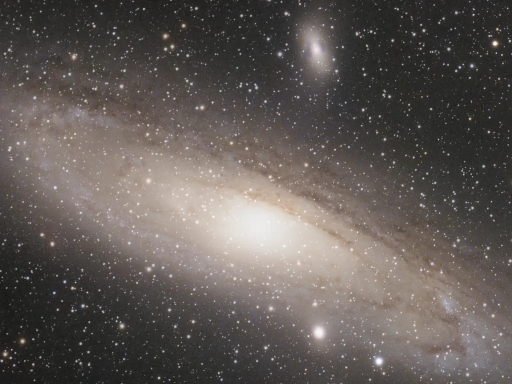

# M31 from Belfast

A processing pipeline for one target, the Andromeda Galaxy (M31), shot with a ZWO Seestar S30 Pro from
a Bortle 6 back garden in rainy Belfast. It pulls the raw 10 s sub-frames off the scope, checks every
frame, stacks them with Siril and finishes the image with GraXpert, Dark Star and a custom stretch. Every
default was chosen by measuring it on this data, and the numbers are given below.

**The journey, step by step, with before/after sliders: <https://m31-belfast.pages.dev>**



## The nights

One folder per night under `data/` (not in git), named by the evening the night started:

| session | conditions |
|---|---|
| `M31_2026-09-07` | dark sky; the scope dropped 22 % of exposures (cause unknown; see [lab notes](docs/lab-notes.md)); 467 subs kept |
| `M31_2026-09-25` | night of 25/26, near-full moon, sky 3.4x brighter than Sep 7, sharper stars |
| `M31_2026-10-16` | 375 subs, the sharpest night (9.4" stars) |
| `M31_combined_<date>` | every night's QA-selected frames stacked together |

## Quick start

Requirements: an arm64 Mac with Homebrew `bash` 5 (the scripts re-exec under it; macOS's bash 3.2
mis-parses `post_process.sh`), [uv](https://docs.astral.sh/uv/), Siril 1.4.4 and GraXpert 3.0.2 in
`/Applications`, and the ASTAP command-line solver with its D50 database in `tools/astap/cli` and
`tools/astap/db` (not in git). The Dark Star model is in `tools/darkstar`. Node 25 for the site.

```bash
uv sync                                         # Python 3.12 venv in .venv
scripts/pull_frames.sh "M 31" 20261016 data/M31_2026-10-16   # copy one night off the scope (see below)
make night SESSION=data/M31_2026-10-16          # qa -> deband -> flat -> stack -> post
make combine                                    # stack every night's frames together
make site                                       # build the journal site (site/dist)
make privacy-check                              # no private terms, coordinates or metadata in the tree
make deploy                                     # build, check site/dist, deploy to Cloudflare Pages
```

Single stages and overrides:

```bash
./run_pipeline.sh data/M31_2026-09-07 qa                       # re-run just QA
STACK_ARGS="--weight wfwhm" ./run_pipeline.sh data/M31_2026-09-07 stack post
POST_ARGS="--target-bg 0.12 --rotate 90" ./run_pipeline.sh data/M31_2026-09-07 post
scripts/combine_sessions.sh data/M31_combined_2026-10-17 data/M31_2026-09-07 data/M31_2026-09-25 data/M31_2026-10-16
```

The M31 defaults are collected in [`config/m31.env`](config/m31.env) with the reason for each one.
`run_pipeline.sh` passes them to each stage ahead of `QA_ARGS`, `DEBAND_ARGS`, `FLAT_ARGS`, `STACK_ARGS`
and `POST_ARGS`, so anything you set in the environment wins.

After `post`, `scripts/record_result.sh` copies the result to `final/history/<timestamp>.jpg`, appends a
line (commit, frames, minutes, SNR, FWHM, stack settings) to `final/history.log`, and points
`data/M31_latest` at the session.

## Pipeline stages and why each default is what it is

Numbers are from [`docs/REVIEW.md`](docs/REVIEW.md) (an independent review run on the Sep 7 data) and
[`docs/lab-notes.md`](docs/lab-notes.md) unless stated.

| stage | script | default | measured reason |
|---|---|---|---|
| pull | `pull_frames.sh` | read-only SMB mount, size-verified copy that resumes | the scope's Samba drops long copies; a rerun skips files already copied |
| QA | `qa_frames.py` | absolute caps only: FWHM > 1.5x the session median, roundness < 0.75, cloud tests; no trend-relative culling | trend-relative FWHM/roundness rejection cost 12 % SNR for a 3 % FWHM gain |
| deband | `deband.py --axis both` | correct only what is measurable | Sep 7: rows 0.14 ADU against a 0.20 ADU noise floor (left alone); columns a 0.50 ADU fixed pattern at 3.3x its floor (subtracted) |
| flat | `synth_flat.py` | measure, and apply only if real | with M31 masked out the sky is flat to 1-2 %; the 17-22 % "vignetting" a naive box measurement found was the galaxy's own light |
| stack | `stack.sh` | Siril 2-pass registration, Bayer drizzle 1x, winsorized 3/3, **nbstars** weighting, **mid-session** reference | wFWHM weighting cost 17-23 % SNR for 9 % smaller stars; the sharpest-frame reference sat at one end of the 19.4 deg field rotation and left three corners at 2x noise; 2x drizzle bought 3 % FWHM |
| combine | `combine_sessions.sh` | frames from all nights in one stack, QA per night, **noise** weighting, framing current | Sep 7 + moonlit Sep 25/26: +14 % SNR at fixed M31 positions over Sep 7 alone (about 15 % predicted); pooled QA rejected the moonlit night as "cloud" |
| solve | `post_process.sh` | ASTAP with SIP distortion terms | needed for colour calibration and for measuring at fixed M31 positions |
| gradient | `post_process.sh` | Siril `subsky 1`, before colour calibration | GraXpert's AI model removed about half of M31's outer halo (3.3 -> 1.7 ADU above sky at 37' on the minor axis); a first-order polynomial flattens the sky as well (corner range 1.2 -> 0.4 ADU) and keeps it |
| colour | `post_process.sh`, `cc_correct.py` | PCC with local Gaia (offline), else NOMAD, then corrected to the SPCC balance | headless SPCC segfaults in Siril 1.4.4; NOMAD PCC is too blue (lavender), local-Gaia PCC too red. Correction factors are SPCC/PCC measured on the same stacks; on Oct 16, an independent check, the prediction was R 0.732 G 0.583 against a measured 0.769 / 0.576 |
| denoise | `post_process.sh` (GraXpert AI) | strength 0.8 | strength is an exact linear blend with the input: at 0.8 green sky noise drops 3.4x with no measurable loss of 2-8 px structure |
| stars | `destar.py` (Dark Star, per-channel mono passes) | relative core protection | < 2.5 % residual and no colour blocks, unlike a single colour pass; the old absolute core threshold collapsed under moonlight and left a dark ring round the nucleus, so the protected zone is now set relative to the nucleus, independent of sky level |
| stretch | `stretch.py` | auto-crop, sky at 0.10, sky-only smoothing, grey sky, highlight knee, stars screened back at 0.7 | darker sky plus sky-only smoothing gave 13 % sky noise against the Seestar JPEG's 15 %; sky-only smoothing alone 18 % -> 11 %; the knee stops the nucleus clipping to a white disc |

Session layout:

```
data/M31_2026-09-07/
  lights/          raw CFA subs from the scope
  seestar_stack/   the scope's own live stack, for comparison
  qa/              frames.csv, summary.json, report.html, plots, selected/rejected lists
  lights_good/     hard links to frames that passed QA
  lights_db/       debanded (or linked unchanged) frames, Siril's input
  masters/         synthetic flat and its verdict
  stack/           result.fit (32-bit linear RGB) and the Siril log
  final/           01_solved 02_bg 03_cc 04_dn 05_starless 05_stars, final.{tif,png,jpg}, history/
```

## Getting frames off the scope

1. Put the Seestar in Station mode (app: device settings, Station Mode, join the home Wi-Fi). It appears
   as `seestar.local` with a guest SMB share called `EMMC Images`.
2. Check `route -n get seestar.local` reports `en0`. If a tunnel or other split route on the Mac covers the
   scope's LAN address, it black-holes the traffic: disconnect it, or add a host route via `en0`.
3. `scripts/pull_frames.sh "M 31" YYYYMMDD data/M31_<evening date>` copies that date's subs and live stack.
   A night that crosses midnight needs a second run for the next date into the same folder.
4. The scope's Wi-Fi can drop out mid-copy. A dead soft mount then fails every copy with "size mismatch":
   `umount -f ~/mnt/seestar` and rerun. Expect about 10 frames a minute.

USB mass storage enumerated but would not mount on this Mac; Wi-Fi is the reliable path.

## Capture lessons (no software recovers these)

- **Refocus during the session.** On Sep 7 the focuser never moved while FWHM grew from about 13" to 17" (15-minute medians, `scripts/make_charts_data.py`).
- **Consider 20 s subs on calm nights.** Read noise is 26-30 % of the per-pixel variance at 10 s, so 20 s
  gains about 8 % (green) to 18 % (blue) SNR per hour, at the cost of more wind rejections.
- **Image each night over similar hours.** Field rotation follows the hours imaged; nights over different
  hours overlap fully only in the middle, and the combined crop clips M31's disc.

## Tried and rejected

| option | result on this data |
|---|---|
| wFWHM stack weighting | -17 to -23 % SNR for 9 % smaller stars |
| GraXpert AI background extraction | removed about half of M31's halo |
| per-frame `seqsubsky` before registration (moonlit night) | sky tilt 16.4 % -> 1.7 %, but halo SNR fell 15-55 % |
| `--framing max --maximize` across nights | ragged canvas that broke star removal and the crop |
| VeraLux HyperMetric Stretch | M31 far too dark: it maps the 99th percentile (stars) to 0.98 |
| single colour pass in Dark Star | magenta/green tile blocks on faint sky |
| 2x drizzle, Siril RL deconvolution | +3 % FWHM; about 1 % FWHM with deep rings |

## Docs

- [`docs/REVIEW.md`](docs/REVIEW.md): the independent review (2026-09-09) behind most defaults, and the
  prompt that produced it in [`docs/REVIEW_PROMPT.md`](docs/REVIEW_PROMPT.md).
- [`docs/lab-notes.md`](docs/lab-notes.md): what was measured night by night, including the dead ends.
- [`config/m31.env`](config/m31.env): every M31-specific default and why.
- `site/`: the Astro journal site; its numbers come from `site/src/data/`.
- [`CLAUDE.md`](CLAUDE.md): conventions for Claude Code sessions in this repo.

## License and credits

Our code is MIT licensed (see [LICENSE](LICENSE)). The Dark Star star-removal model in `tools/darkstar`
is MIT licensed by Seti Astro (from the `setiastro/cosmicclarity` releases). Processing uses
[Siril](https://siril.org), [GraXpert](https://graxpert.com), Dark Star and
[ASTAP](https://www.hnsky.org/astap.htm); images were made with a ZWO Seestar S30 Pro.
